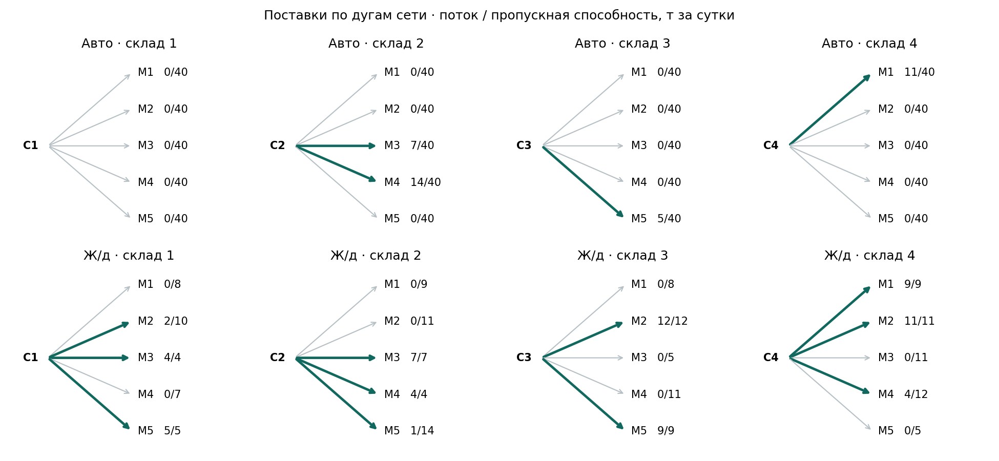

# ЛР2. Доставка со складов автотранспортом и по железной дороге

**Вариант 17, № 28, Б24-527.** Минимальная стоимость доставки 105 т составляет **16 079 руб. за сутки**. Автомобили везут 37 т, железная дорога — 68 т. Наибольший суточный поток на одной дуге равен 14 т. Он идёт автомобилем со склада 2 в магазин 4.

## Сеть и ЛП

Четыре склада имеют запасы $a=(28,33,26,35)$ т, пять магазинов предъявляют спрос $b=(20,25,18,22,20)$ т. Из каждого склада в каждый магазин идут две параллельные дуги, всего 40. Объём $x_{ijk}$ — тонны со склада $i$ в магазин $j$ видом транспорта $k$ за сутки. При стоимости $c_{ijk}$ в руб./т и суточном лимите $u_{ijk}$ в тоннах модель имеет вид

$$\min \sum_{ijk} c_{ijk}x_{ijk},\qquad
\sum_{jk}x_{ijk}\le a_i,\quad
\sum_{ik}x_{ijk}=b_j,\quad 0\le x_{ijk}\le u_{ijk}.$$

Неиспользованный запас остаётся на складе. Для явной модели баланса это остаток $r_i=a_i-\sum_{jk}x_{ijk}\ge0$. Тарифы линейны по тоннажу. Генератор с seed 10228 выбирает расстояния $d_{ij}$ от 40 до 200 км. Тариф авто равен $2d_{ij}+25$, железнодорожный тариф равен $d_{ij}+68$. Автоёмкость — 40 т на дугу, железнодорожные лимиты генерируются от 4 до 14 т. [Тарифы, лимиты и спрос](data.json).



Каждая панель показывает исходящие дуги одного склада для одного вида транспорта. Например, на направлении С2 → М4 дополнительно к 14 т на автомобиле поставляются 4 т железной дорогой. Из четырёх складов отгружено 11, 33, 26 и 35 т. Остаток 17 т сосредоточен на первом складе. Все пять магазинов получили в точности заказанные объёмы. [Потоки всех дуг](results/solution.csv) и [балансы всех вершин](results/balances.csv).

## Устойчивость перевозок

| Сценарий | Авто / ж/д, т | Стоимость, руб. | Последствие |
|---|---:|---:|---|
| База | 37 / 68 | 16 079 | Все заявки закрыты |
| Перегрузка С2 → М4 авто, лимит 7 т | 23 / 82 | 16 198 | +119 руб. |
| Отказ той же дуги, лимит 0 т | 15 / 90 | 16 349 | +270 руб. |
| Спрос каждого магазина +20% | — | — | Требуется 126 т, имеются 122 т |
| Рост спроса и отказ одновременно | — | — | Недостаёт как минимум 4 т |

Для отказа выбрана дуга с наибольшим **абсолютным потоком** в базовом плане. Перегрузка задаёт доступный лимит в половину этого потока. При полном отказе часть грузов перенаправляется и перераспределяются поставщики. Стоимость возрастает примерно на 1,68%. Первая и две следующие строки имеют статус optimal. Для последних двух статус infeasible подтверждается суммированием балансов всех магазинов и складских лимитов. [Полный результат сценариев](results/scenarios.csv).

## Двойственные оценки и эвристика

Железнодорожные дуги С1–М3, С1–М5, С2–М3, С2–М4, С3–М2, С3–М5, С4–М1 и С4–М2 насыщены. На С4–М2 дополнительная тонна пропускной способности локально экономит 46 руб., на С2–М3 — 24 руб., на С2–М4 — 22 руб. На насыщенной С1–М5 предельная экономия равна нулю. Сам факт насыщения ещё не устанавливает ценность расширения. Магазин 2 имеет наибольшую предельную стоимость дополнительной тонны спроса — 266 руб.

Жадный алгоритм обходит дуги в порядке роста тарифа и отправляет минимум из остатка запаса, спроса и лимита. На тех же данных он закрывает весь спрос за 16 810 руб. Переплата относительно оптимума $731/16079=4{,}55\%$. Выгодная ранняя поставка расходует запас, который может оказаться ценнее для другого магазина. Целочисленная версия в тоннах дала ту же стоимость 16 079 руб. У матрицы такой транспортной сети целочисленные вершины при целых запасах, спросе и лимитах.

## Проверка и применение

HiGHS решает непрерывную модель двойственным симплекс-методом с presolve. Проверка отдельно суммирует входящие и исходящие потоки, сверяет все 40 границ дуг и пересчитывает стоимость NumPy. Для базовой эвристики и целочисленной версии выполнена та же проверка. Допуск $10^{-7}$. [Проверки](results/checks.json) и [лог HiGHS](results/solver.log).

План можно использовать для суточного распределения тоннажа. Для составления расписания потребуются вместимость машин и вагонов, время подачи и отправления, а также фиксированная цена заказа рейса.

## Запуск из корня репозитория

```console
python -m pip install -r requirements.txt
python lab2/solve.py
```

`python lab2/solve.py --generate` воспроизводит данные. [Исходный код](solve.py).
