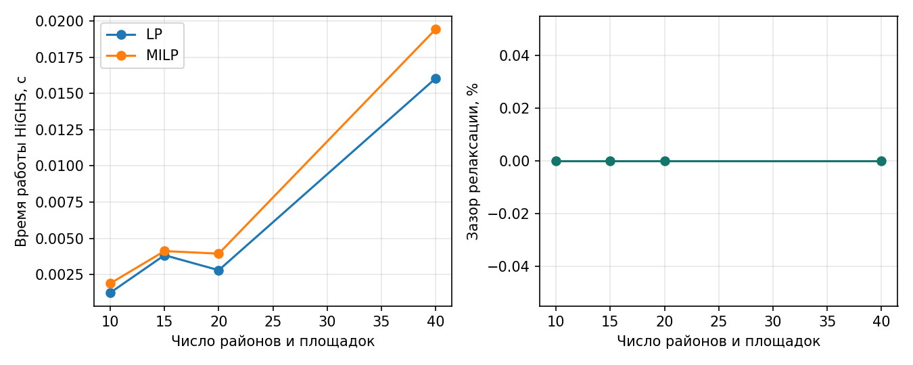

# ЛР3. Размещение трёх точек доставки

**Вариант 17, № 28, Б24-527.** Для 15 районов оптимально открыть площадки **1, 2 и 12**. Они обслуживают соответственно 72, 98 и 98 доставок в сутки. Минимальная транспортная работа равна **7 058 заказо-км в сутки**.

## Данные и модель p-медианы

Множество $I$ содержит районы спроса, $J$ — кандидатные площадки. Координаты заданы в км, $d_i$ — число заказов района за сутки, $c_{ij}$ — манхэттенское расстояние между районом и площадкой. Оно приближает длину пути по прямоугольной уличной сети. Генератор с seed 10228 последовательно создаёт 40 пар координат районов, 40 пар координат площадок (целые числа 0–100), затем 40 значений спроса (8–35). Для базовой задачи берём первые 15 каждой серии. Для испытаний масштаба сохраняем вложенные выборки. [Исходные данные](data.json).

Бинарная переменная $y_j$ означает открытие площадки, непрерывная $x_{ij}$ — число заказов района $i$, обслуженных площадкой $j$. При линейных затратах каждый район можно целиком передать ближайшей открытой площадке. При равных расстояниях деление объёма допустимо.

$$\min \sum_{ij} c_{ij}x_{ij},\qquad \sum_j y_j=3,\quad
\sum_j x_{ij}=d_i,\quad 0\le x_{ij}\le d_i y_j,\quad y_j\in\{0,1\}.$$

Недоступной площадке задаём $y_j=0$. Это дискретный выбор трёх адресов. В LP-релаксации открытие может принимать любое значение от 0 до 1. Для 15 районов модель содержит 15 бинарных и 225 непрерывных переменных. SciPy передаёт разреженную матрицу в HiGHS с presolve. MILP решается методом ветвей и границ с отсечениями и заданным относительным зазором остановки 0.

## Оптимальные адреса и сценарии

| Условия | Закрыты | Открыты | LP | MILP | Жадное решение |
|---|---|---|---:|---:|---:|
| База | — | 1, 2, 12 | 7 058 | 7 058 | 7 863 |
| Дефицит площадок | 2 | 5, 7, 14 | 7 283 | 7 283 | 7 958 |
| Стресс | 2, 12 | 5, 7, 14 | 7 283 | 7 283 | 7 958 |
| База, увеличенный big-M | — | 1, 2, 12 | 4 581 | 7 058 | 7 863 |

Для дефицита и стресса исключаем одну и две наиболее загруженные базовые площадки. При равной загрузке выбираем меньший номер. Запрет № 2 повышает транспортную работу на 225 заказо-км (3,19%). Запрет № 12 уже не влияет на найденный альтернативный набор. В базе площадка 1 обслуживает районы 3, 4, 14, площадка 2 — районы 1, 2, 6, 9, 11, остальные семь районов закреплены за № 12. [Распределение заказов](results/allocations.csv) и [значения всех переменных открытия](results/solution.csv).

## Сила связки и два вида зазора

Коэффициент $M_i=d_i$ — достаточная и наименьшая универсальная граница на индивидуальную поставку, поскольку один район выдаёт всего $d_i$ заказов. Целочисленная модель сохраняет смысл и при $M_i=100d_i$ вместе с физическим ограничением $x_{ij}\le d_i$. Когда $y_j=0$, площадка закрыта в обеих версиях. Когда $y_j=1$, район по-прежнему может передать весь спрос этой площадке.

В сильной базовой релаксации HiGHS нашёл целые открытия и зазор равен нулю. В слабой версии $y_2=0{,}01$ уже позволяет обслужить все 34 заказа второго района на площадке 2. Такое «открытие» нельзя реализовать. Нижняя оценка падает до 4 581, и интегральный зазор $(7058-4581)/7058$ достигает 35,09%. В обеих целочисленных постановках решатель доказал оптимальность 7 058. Итоговый зазор ветвления равен нулю и характеризует завершённый поиск, тогда как интегральный зазор сравнивает оптимумы двух разных моделей.

## Эвристика, масштаб и контроль

Эвристика добавляет по одной площадке, на каждом шаге минимизируя суммарный пробег до ближайшей уже выбранной или новой площадки. Она выбрала 9, 2 и 12. Результат 7 863 хуже оптимума на 805 заказо-км, или 11,41%. В сохранённом базовом запуске эвристике потребовалось около 0,27 мс, решению MILP — 4,12 мс. Время зависит от машины, нагрузки и прогрева решателя. На росте масштаба сравнивается один запуск на размер, поэтому малые различия во времени не дают статистической оценки.



| Районы × площадки | LP и MILP, заказо-км | MILP, мс | Зазор релаксации |
|---|---:|---:|---:|
| 10 × 10 | 4 510 | 1,89 | 0% |
| 15 × 15 | 7 058 | 4,12 | 0% |
| 20 × 20 | 8 711 | 3,95 | 0% |
| 40 × 40 | 20 552 | 19,43 | 0% с точностью вычислений |

Независимая проверка NumPy контролирует открытие ровно трёх площадок, целочисленность, запреты, балансы районов, связки и стоимость с допуском $10^{-7}$. Для размеров до 20 дополнительно перебраны все допустимые тройки. Для базового варианта это 455 троек: проверка сводится к суммированию расстояний до ближайшей точки для каждого района и даёт тот же оптимум. [Проверки](results/checks.json), [измерения всех сценариев](results/scenarios.csv) и [лог HiGHS](results/solver.log).

Модель подходит для выбора адресов по взвешенной близости. До открытия точек следует учесть реальную дорожную сеть, аренду, пропускную способность площадок и интервалы доставки.

## Запуск из корня репозитория

```console
python -m pip install -r requirements.txt
python lab3/solve.py
```

`python lab3/solve.py --generate` воспроизводит файл данных. [Исходный код](solve.py).
